# Windows Terminal Shaders

Shaders for the new Windows Terminal

## How to use

- Checkout the repository
- Set the value for `experimental.pixelShaderPath` in your terminal setting to the desired shader
- **optional:** Add keybindings for turning the shader on/off and focusmode

### Example Setting

> Please add the lines you need to your own config, this example config only show the values that you need to add.

```jsonc
{
  "profiles": {
    "defaults": {
      // Add your desired shader
      "experimental.pixelShaderPath": "C:\\gitrepos\\windows-terminal-shaders\\crt.hlsl"
    }
  },
  "keybindings": [
    // It's recommended to add those two toggles for ease of use
    {
      "command": "toggleFocusMode",
      "keys": "shift+f11"
    },
    {
      "command": "toggleShaderEffects",
      "keys": "shift+f10"
    }
  ]
}
```

## [CRT](./crt.hlsl)

### Preview

| 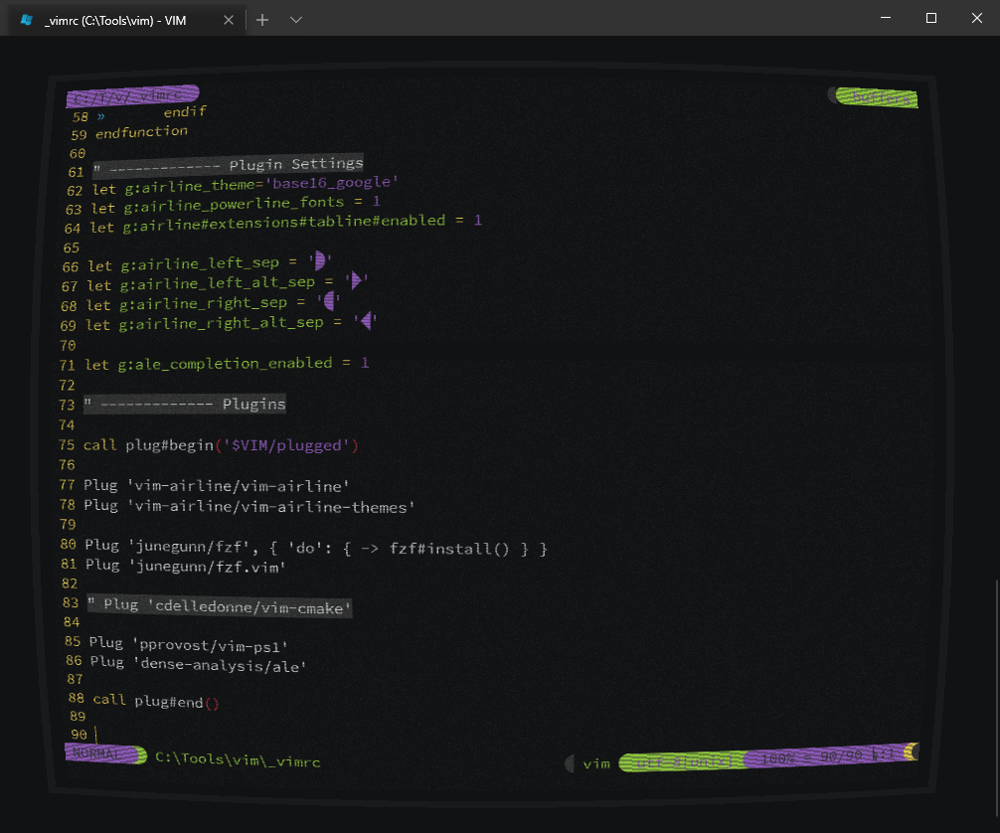 | 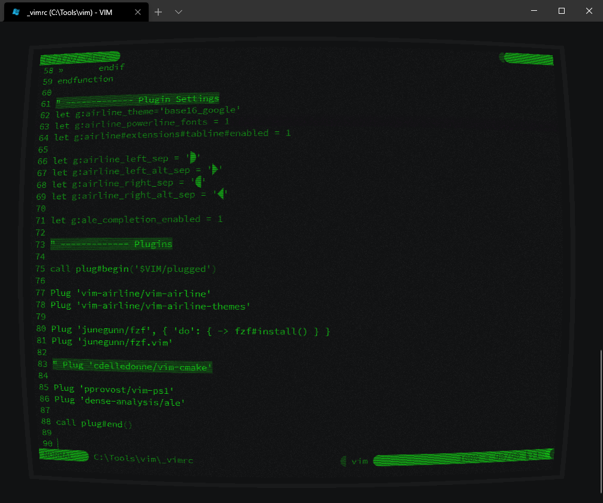 | 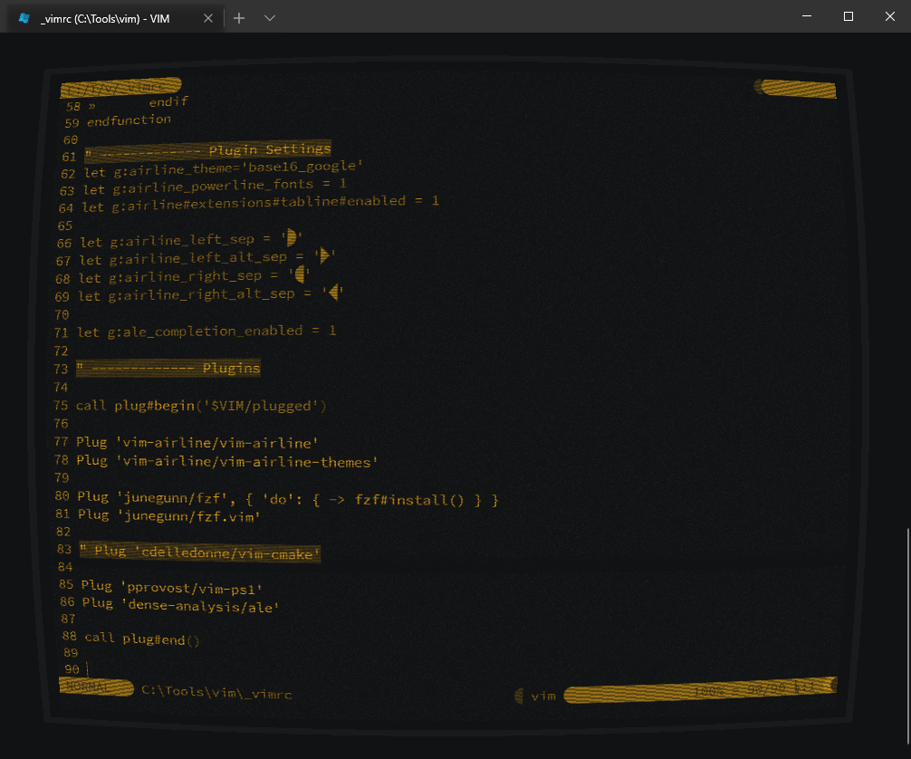 | 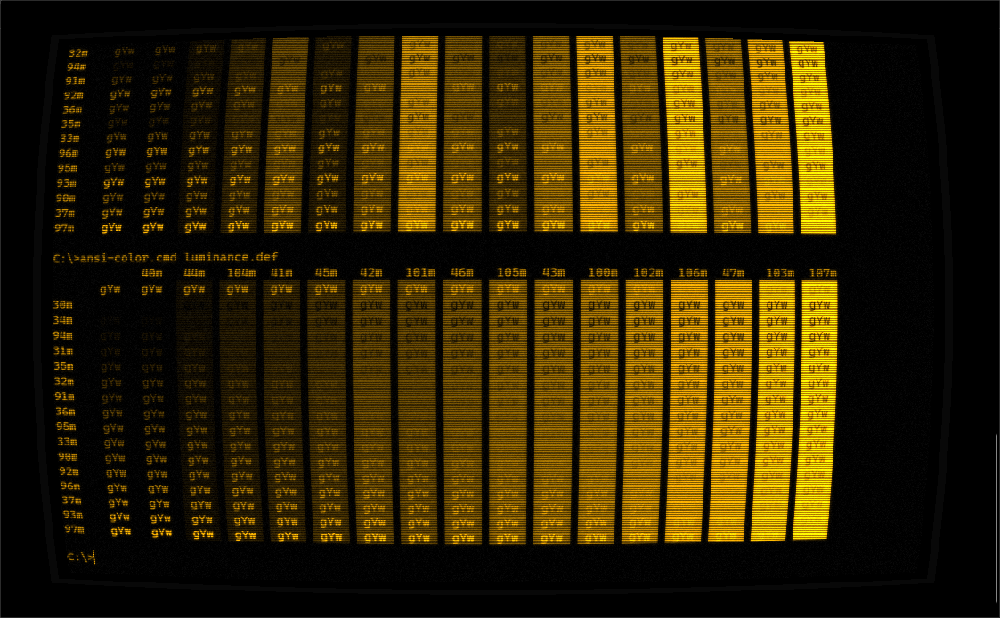                                                         |
| -------------------------- | -------------------------- | -------------------------- | ---------------------------------------------------------------------------------- |
| Default                    | Green Monochrome           | Ember Monochrome           | With Luminance, Grayscale, Tint, Grain, Refresh, Scanlines, Bloom, Blur, and Curve |

### Grayscale conversion

| 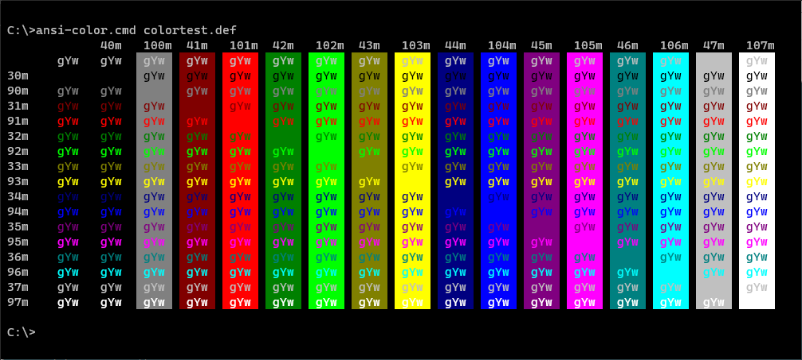 | 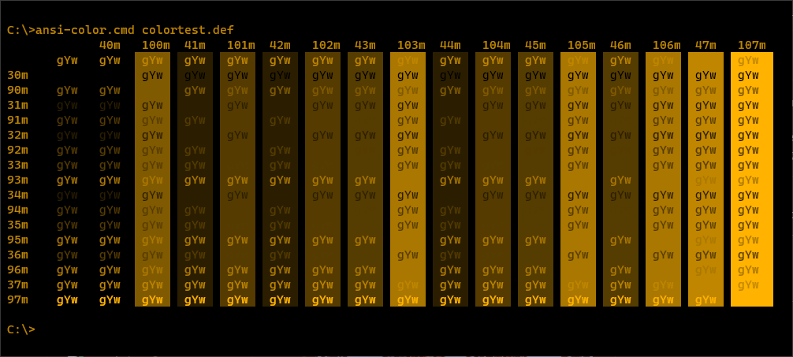 | 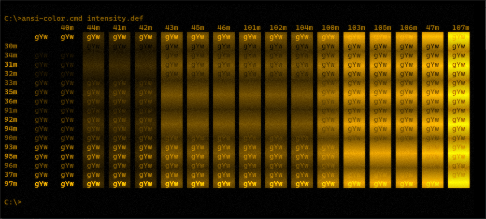 |
| --------------------------------------- | --------------------------------------- | ------------------------------------------- |
| Vintage Color Scheme                    | Default without Grayscale conversion    | Intensity Strategy †                        |

| 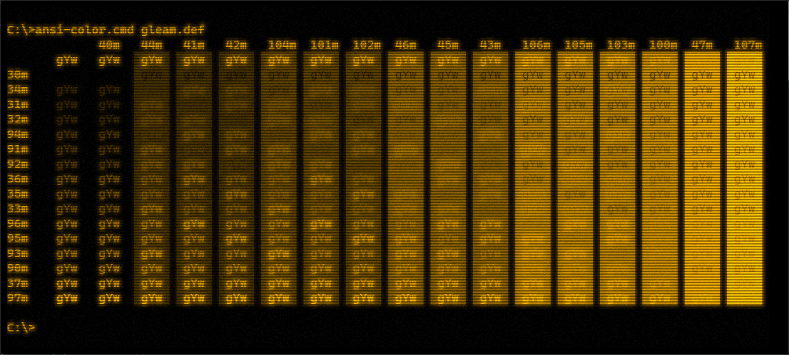 | 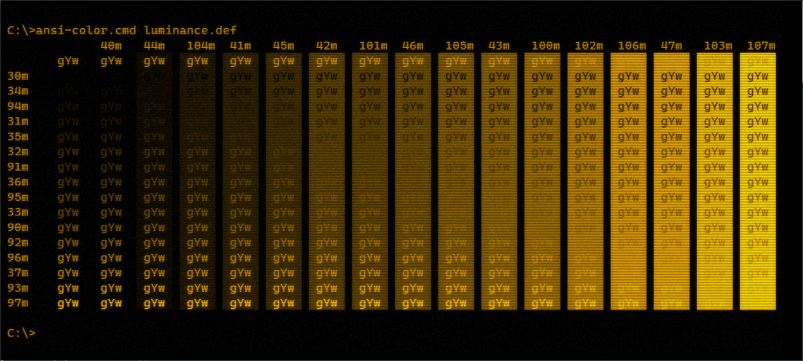 | 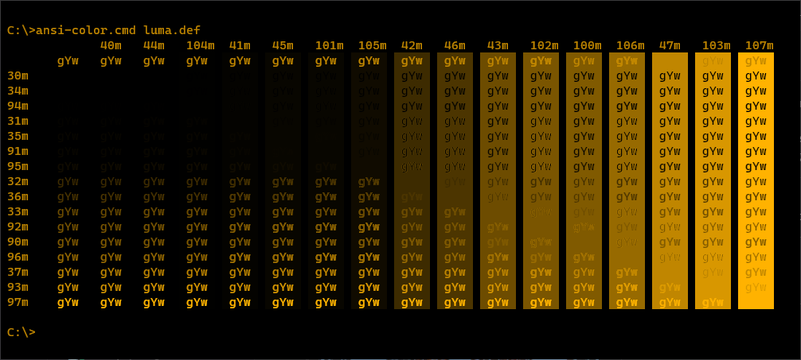 |
| ----------------------------------- | ------------------------------------------- | --------------------------------- |
| Gleam Strategy †                    | Luminance Strategy †                        | Luma Strategy †                   |

† The order of [SGR ANSI Escape Codes](https://en.wikipedia.org/wiki/ANSI_escape_code#Colors) have been adjusted to demonstrate a smooth transition from dark to light, but the order will change because there is no perfect way to convert color to grayscale. There are advantages and disadvantages of all strategies.

---

#### Regarding Retro.hlsl license

This shader takes advantage of some of the techniques showcased in [Retro.hlsl](https://github.com/microsoft/terminal/blob/fb597ed304ec6eef245405c9652e9b8a029b821f/samples/PixelShaders/Retro.hlsl), for applying scanlines. These changes are MIT License and so therefore not being committed to the main branch until licensing needs can be addressed. This branch is so that these changes can be maintained and tracked until this can be resolved.

---

### Settings

When using a monochorme tint, there should be some considerations made. The Vintage color scheme is probably the best choice for trying to capture a nostalgic feel. Other color schemes, while still being monochormatic will have different brightness levels which may not correspond with expectations. If ENABLE_GRAYSCALE is used, there are four different strategies, one of which should be selected. Intensity, Gleam, Luminance, and Luma are calculated using the formulas on this [Color-to-Grayscale](https://journals.plos.org/plosone/article?id=10.1371/journal.pone.0029740) paper. While there isn't a perfect conversion technique, and the results change considerably depending on the color scheme used, Luminance seems to provide the smoothest transitions using Vintage as the base. It is also recommended that the Windows Terminal [fontFace](https://docs.microsoft.com/en-us/windows/terminal/customize-settings/profile-appearance#font-face) and [antialiasingMode](https://docs.microsoft.com/en-us/windows/terminal/customize-settings/profile-advanced#text-antialiasing) settings are adjusted to improve readability as desired. Lastly, this is applying a pixel shader to the entire window. Depending on the system hardware and the size of the screen, this might be a very expensive shader to apply at max settings.

`ENABLE_CURVE` : Draws the monitor frame and gives the illusion of rendering on a curved glass CRT.  
`ENABLE_OVERSCAN` : Adds an overscan buffer to the display so that the content isn't right up against the edges. This improves the ability to see the cursor when it is a bar.  
`ENABLE_BLOOM` : Enhances the leading edge of a change in the electron beam. An artifact of how older CRTs drew, but in some cases it helps increase contrast and helps improve readability.  
`ENABLE_BLUR` : Causes the brigher phosphors to bleed some light into neighboring areas similar to the glass on old CRTs.  
`ENABLE_GRAYSCALE` : Converts the color to monochrome. Probably most useful when used with ENABLE_TINT.  
`ENABLE_REFRESHLINE` : Introduces a refresh artifact, simulating when the refresh is slightly out of sync.  
`ENABLE_SCANLINES` : Adds hard raster lines to the display output to simulate each scanline.  
`ENABLE_TINT` : Used with ENABLE_GRAYSCALE to simulate amber or green phosphor monochrome monitors. It can also apply a warm or cool tint to shift the colors slightly more red or slightly more blue.  
`ENABLE_GRAIN` : Adds a low intensity white noise snow to the screen to simulate the static of an analog signal.  
`ENABLE_BLACKLEVEL` : Raises the blacklevel floor. Especially old monochrome CRTs still illuminated some phosphors when showing black. This controls how black the black color is displayed.

```c++
// Shader Options
#define ENABLE_CURVE            1
#define ENABLE_OVERSCAN         1
#define ENABLE_BLOOM            1
#define ENABLE_BLUR             1
#define ENABLE_GRAYSCALE        1
#define ENABLE_REFRESHLINE      1
#define ENABLE_SCANLINES        1
#define ENABLE_TINT             1
#define ENABLE_GRAIN            1
#define ENABLE_BLACKLEVEL       1
```

```c++
// Settings - Curve (crt.hlsl only)
#define CURVE_INTENSITY         1 // Increases or decreases the intensity of the curve. Ex: 0.5 = half intensity, 2 = double intensity

// Settings - Overscan
#define OVERSCAN_PERCENTAGE     0.02

// Settings - Bloom
#define BLOOM_OFFSET            0.0015
#define BLOOM_STRENGTH          0.8

// Settings - Blur
#define BLUR_MULTIPLIER         1.05
#define BLUR_STRENGTH           0.3
#define BLUR_OFFSET             0.003

// Settings - Grayscale
#define GRAYSCALE_INTENSITY     0
#define GRAYSCALE_GLEAM         0
#define GRAYSCALE_LUMINANCE     1
#define GRAYSCALE_LUMA          0

// Settings - Blacklevel
#define BLACKLEVEL_FLOOR        TINT_COLOR / 40

// Settings - Tint
// Colors variations from https://superuser.com/a/1206781
#define TINT_COLOR              TINT_AMBER

#define TINT_AMBER              float3(1.0, 0.7, 0.0) // P3 phosphor
#define TINT_LIGHT_AMBER        float3(1.0, 0.8, 0.0)
#define TINT_GREEN_1            float3(0.2, 1.0, 0.0)
#define TINT_APPLE_II           float3(0.2, 1.0, 0.2) // P1 phosphor
#define TINT_GREEN_2            float3(0.0, 1.0, 0.2)
#define TINT_APPLE_IIc          float3(0.4, 1.0, 0.4) // P24 phpsphor
#define TINT_GREEN_3            float3(0.0, 1.0, 0.4)
#define TINT_WARM               float3(1.0, 0.9, 0.8)
#define TINT_COOL               float3(0.8, 0.9, 1.0)

// Settings - Gain
#define GRAIN_INTENSITY         0.02
```

## [Fallout Terminal](./fallout-terminal.hlsl)

A Fallout / Pip-Boy inspired CRT treatment with dark and light ANSI palettes,
phosphor glow, scanlines, glass optics, analog drift, and an optional
monochrome-green color mode. The implementation is original and does not use
game assets.

### Preview

| Curved glass | Flat screen |
| ------------ | ----------- |
| 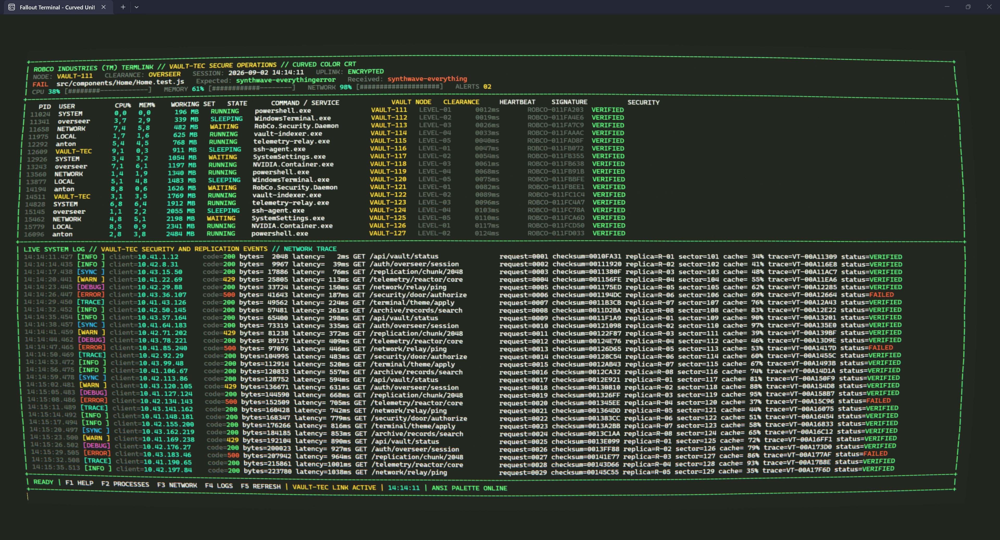 | 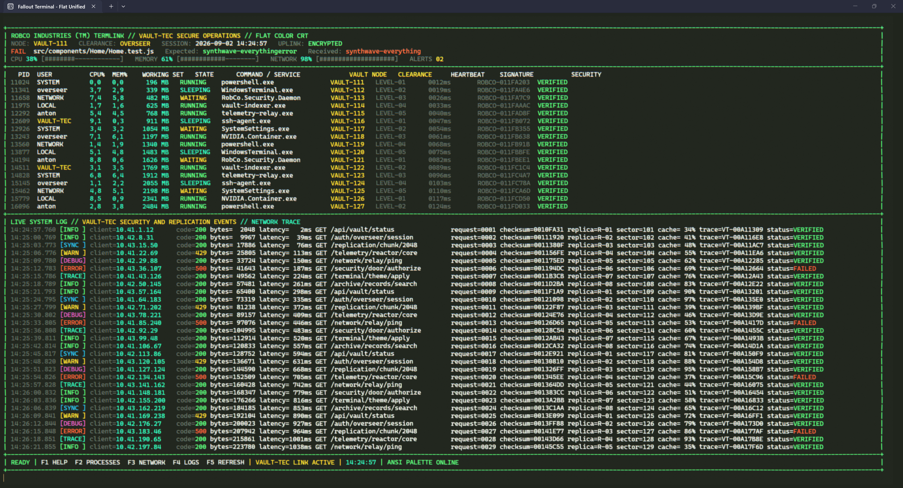 |

### Color palette

[`fallout-color-scheme.json`](./fallout-color-scheme.json) contains two matching
schemes. `Fallout Terminal Color` uses a dark green-gray screen background,
warm neutral foreground text, and bright saturated ANSI colors. `Fallout
Terminal Light` uses a neutral pale green-gray background with dark ANSI colors;
every foreground color has at least a 4.7:1 contrast ratio against the
background. ANSI black remains distinct from the background in both schemes.

| UI color | Value |
| -------- | ----- |
| Background | `#20251D` |
| Foreground | `#E7EBDF` |
| Cursor | `#F5FFD7` |
| Selection | `#3B7D40` |

| ANSI color | Normal | Bright |
| ---------- | ------ | ------ |
| Black | `#070A08` | `#59665A` |
| Red | `#F23D21` | `#FF5A32` |
| Green | `#28E956` | `#55FF75` |
| Yellow | `#E8B918` | `#FFD52B` |
| Blue | `#1687B8` | `#25B4E6` |
| Purple | `#A63C8C` | `#DF55B9` |
| Cyan | `#18C48E` | `#2CF4B3` |
| White | `#D9DDCF` | `#FFFFFF` |

#### Light palette

| UI color | Value |
| -------- | ----- |
| Background | `#EEF2EC` |
| Foreground | `#182318` |
| Cursor | `#285F2B` |
| Selection | `#C1D0BE` |

| ANSI color | Normal | Bright |
| ---------- | ------ | ------ |
| Black | `#0B100C` | `#566052` |
| Red | `#9D241F` | `#B82B24` |
| Green | `#176426` | `#1D7730` |
| Yellow | `#715600` | `#856500` |
| Blue | `#185B7A` | `#1B6D91` |
| Purple | `#712B60` | `#873573` |
| Cyan | `#00645B` | `#00776C` |
| White | `#596357` | `#263226` |

Keep `FALLOUT_COLOR_MODE` set to `0` to display these colors without
monochrome phosphor grading. Both palettes work with both shader variants. The
dedicated light variants use restrained ink-style optics instead of additive
phosphor bloom, keeping dark glyphs crisp and palette colors intact.

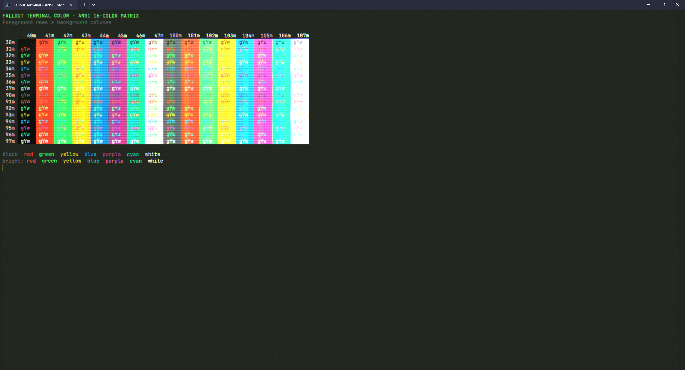

### Variants

- [`fallout-terminal.hlsl`](./fallout-terminal.hlsl) uses curved glass and a
  safe content inset so text remains visible around the distorted edges.
- [`fallout-terminal-flat.hlsl`](./fallout-terminal-flat.hlsl) keeps the image
  rectangular, removes the inset and vignette, and fills the terminal viewport.
- [`fallout-terminal-light.hlsl`](./fallout-terminal-light.hlsl) is the curved
  light-palette variant with restrained effects.
- [`fallout-terminal-flat-light.hlsl`](./fallout-terminal-flat-light.hlsl) is
  the rectangular light-palette variant.

Both variants include the same color, phosphor, glow, and analog signal effects.

### Installation

Add the scheme from `fallout-color-scheme.json` to the `schemes` array in
Windows Terminal's `settings.json`, then set the scheme and shader on a profile:

```json
{
  "colorScheme": "Fallout Terminal Color",
  "experimental.pixelShaderPath": "C:\\path\\to\\fallout-terminal.hlsl"
}
```

For the light version, select the matching light shader and scheme:

```json
{
  "colorScheme": "Fallout Terminal Light",
  "experimental.pixelShaderPath": "C:\\path\\to\\fallout-terminal-light.hlsl"
}
```

Use `fallout-terminal-flat.hlsl` in `experimental.pixelShaderPath` for the flat
dark variant or `fallout-terminal-flat-light.hlsl` for the flat light variant.
Open a new tab after changing the path so Windows Terminal loads the selected
shader.

The included installer adds both palettes, creates a timestamped settings
backup, and selects the requested combination:

```powershell
.\install-fallout-terminal.ps1 -ShaderVariant Flat -Theme Light
```

Use `-Theme Dark` to switch back without changing the selected shader variant.
Preview either palette directly with `./show-fallout-palette.ps1 -Theme Light`
or `-Theme Dark`.

### Color mode

The palette remains fully colored by default. Enable Fallout color grading to
convert neutral foreground colors to green phosphor while preserving saturated
ANSI hues:

```c++
// 0 = preserve palette colors, 1 = apply Fallout phosphor grading
#define FALLOUT_COLOR_MODE 0
```

### Effects

| Effect | Setting | Description |
| ------ | ------- | ----------- |
| Screen curvature | `ENABLE_CURVATURE` | Bends the image around the outer glass surface. Enabled only in the curved variant. |
| Phosphor glow | `ENABLE_GLOW` | Spreads light from bright glyphs into nearby pixels. |
| Scanlines | `ENABLE_SCANLINES` | Adds horizontal raster lines and a subtle vertical phosphor lattice. |
| Film noise | `ENABLE_NOISE` | Applies restrained animated analog grain without obscuring text. |
| Signal glitches | `ENABLE_GLITCHES` | Adds rare horizontal signal tears and analog drift. Disabled by default. |
| Vignette | `ENABLE_VIGNETTE` | Darkens the outer glass rim. Disabled by default in both supplied variants. |
| Chromatic aberration | `ENABLE_CHROMATIC_ABERRATION` | Separates red and blue channels toward the screen edges. |
| Glass refraction | `ENABLE_GLASS_REFRACTION` | Applies slow sub-pixel waves that simulate uneven glass. |
| Color bleed | `ENABLE_COLOR_BLEED` | Lets bright colors spread slightly in the horizontal direction. |
| Edge defocus | `ENABLE_EDGE_DEFOCUS` | Softens the image progressively toward the edge of the glass. |
| Phosphor mask | `ENABLE_PHOSPHOR_MASK` | Modulates RGB phosphor columns at the physical pixel scale. |
| Halation | `ENABLE_HALATION` | Creates a wider halo around bright text and colored highlights. |
| Convergence drift | `ENABLE_CONVERGENCE_DRIFT` | Adds a slow sub-pixel RGB alignment drift. |
| Glass glare | `ENABLE_GLASS_GLARE` | Draws a faint diagonal reflection across illuminated content. |
| Vertical sync slip | `ENABLE_VERTICAL_SYNC_SLIP` | Produces a rare, brief vertical synchronization jump. |

A rolling refresh band and restrained power flicker are always active. Effect
strengths are grouped below the toggles near the top of each shader; offsets and
radii are expressed in screen pixels so they remain consistent across terminal
sizes.

### Subtle preset

For a cleaner daily-use terminal, set the built-in preset flag to `1` near the
top of either shader:

```c++
#define FALLOUT_SUBTLE_PRESET 1
```

The shader selects every matching lower-intensity value as one consistent
block, including safe glitch strength and displacement values. This avoids
macro redefinition warnings and missing settings when presets are changed.
Curved glass is also reduced automatically in `fallout-terminal.hlsl`; the
flat variant keeps its zero inset. `ENABLE_GLITCHES` and `ENABLE_VIGNETTE`
remain independent toggles and stay set to `0` by default.

## [Cyberpunk 2077 Neon](./cyberpunk-terminal.hlsl)

A dark Cyberpunk 2077 inspired theme: an ANSI palette built on the official UI
style guide colors and a flat neon display shader with glow, RGB split, short
digital glitch bursts, and a scanner sweep. The implementation is original and
does not use game assets.

### Color palette

[`cyberpunk-color-scheme.json`](./cyberpunk-color-scheme.json) contains the
`Cyberpunk 2077 Dark` scheme. Its colors come from the "Colours" pages of the
CD PROJEKT RED user interface style guide published in
[Cyberpunk 2077 User Interface (Part 2)](https://www.behance.net/gallery/133185623/Cyberpunk-2077User-Interface-%28Part-2%29).
The guide defines a main palette of red, cyan, white, and darkest blue, and a
secondary palette of item rarity colors.

| Guide color | Hex | Palette | Used for |
| ----------- | --- | ------- | -------- |
| Red | `#F75049` | Main | Red, selection tint, shader glitch accent |
| Cyan | `#5EF6FF` | Main | Cyan, cursor, scanner sweep |
| White | `#FFFFFF` | Main | Bright white |
| Darkest Blue | `#0E0E17` | Main | Background |
| Grey | `#D6D0D0` | Secondary | Foreground, white |
| Green (Mint Jungle) | `#1DED83` | Secondary | Green |
| Blue (Yale Steel) | `#2570D4` | Secondary | Blue |
| Violet Purple | `#9D2BF5` | Secondary | Purple |
| Orange | `#FB932E` | Secondary | Bright red |
| Yellow (Gold) | `#F0B537` | Secondary | Yellow |

The guide lists Gold as `RGB 241 / 181 / 55` but `HEX #F0B537`; the scheme uses
the published hex value.

The guide has a single value per hue, so the remaining slots are mixes of guide
colors rather than new colors: bright variants add 30% guide white, black and
bright black are 25% and 55% grey over darkest blue, and the selection is 25%
red over darkest blue,
like the translucent red panels of the game's interface.

Bright yellow is the one color from outside the UI guide: the Cyberpunk 2077
brand yellow. CD PROJEKT RED identifies it as Pantone 3945C
([@CyberpunkGame](https://x.com/CyberpunkGame/status/1334549130069368835)), and
`#FCEE0A` is its `.yellow` value on the official site,
[cyberpunk.net](https://www.cyberpunk.net/).

| UI color | Value | Source |
| -------- | ----- | ------ |
| Background | `#0E0E17` | Darkest Blue |
| Foreground | `#D6D0D0` | Grey |
| Cursor | `#5EF6FF` | Cyan |
| Selection | `#481E24` | 25% Red over Darkest Blue |

| ANSI color | Normal | Bright |
| ---------- | ------ | ------ |
| Black | `#403E45` 25% Grey over Darkest Blue | `#7C797D` 55% Grey over Darkest Blue |
| Red | `#F75049` Red | `#FB932E` Orange |
| Green | `#1DED83` Mint Jungle | `#61F2A8` Mint Jungle + 30% White |
| Yellow | `#F0B537` Gold | `#FCEE0A` Brand yellow |
| Blue | `#2570D4` Yale Steel | `#669BE1` Yale Steel + 30% White |
| Purple | `#9D2BF5` Violet Purple | `#BA6BF8` Violet Purple + 30% White |
| Cyan | `#5EF6FF` Cyan | `#8EF9FF` Cyan + 30% White |
| White | `#D6D0D0` Grey | `#FFFFFF` White |

Guide colors are used unchanged, so normal blue and purple have contrast ratios
of 3.97:1 and 3.75:1 against the background; their bright variants reach
6.7:1 and 6.0:1. ANSI black is lighter than the background (1.8:1) so black
text and black panels stay visible, while dark text on yellow, cyan, gold, and
green prompt segments keeps at least a 5.7:1 contrast ratio. Bright red uses the guide's
orange, following the same red-to-orange convention as Solarized. Preview the
palette with `./show-cyberpunk-palette.ps1`.

### Installation

The included installer adds the scheme, creates a timestamped settings backup,
and selects both the scheme and the shader for the default profile:

```powershell
.\install-cyberpunk-terminal.ps1
```

Or add the scheme to the `schemes` array in Windows Terminal's
`settings.json` manually and set it on a profile:

```json
{
  "colorScheme": "Cyberpunk 2077 Dark",
  "experimental.pixelShaderPath": "C:\\path\\to\\cyberpunk-terminal.hlsl"
}
```

Open a new tab after changing the path so Windows Terminal loads the shader.
Run `.\install-fallout-terminal.ps1` to switch back to the Fallout theme.

### Effects

| Effect | Setting | Description |
| ------ | ------- | ----------- |
| Neon glow | `ENABLE_NEON_GLOW` | Adds a two-ring halo around bright glyphs that keeps their hue. |
| RGB split | `ENABLE_RGB_SPLIT` | Separates the red and blue channels horizontally by a fraction of a pixel. |
| Glitch bursts | `ENABLE_GLITCHES` | Occasionally shifts random horizontal bands for a fraction of a second and repaints them in red or cyan. |
| Scanlines | `ENABLE_SCANLINES` | Adds thin display rows instead of a heavy CRT raster. |
| Scanner sweep | `ENABLE_SCAN_SWEEP` | Moves a thin cyan scanner line down the screen at a fixed interval. |
| Neon flicker | `ENABLE_NEON_FLICKER` | Makes the glow buzz and stutter slightly while the glyphs stay steady. |
| Noise | `ENABLE_NOISE` | Applies faint animated digital noise. |
| Vignette | `ENABLE_VIGNETTE` | Darkens the screen corners. Disabled by default. |

Glitch offsets, glow radius, and scanline spacing are expressed in screen pixels
and follow the display scale. Set `CYBERPUNK_SUBTLE_PRESET` to `1` near the top
of the shader for a calmer daily-use preset with weaker effects and rarer glitch
bursts.

## [Transparent](./transparent.hlsl)

Turn a specific color into transparent for use with `useAcrylic` and `acrylicOpacity` when xterm colors are enabled, like in vim themes.

### Preview

| 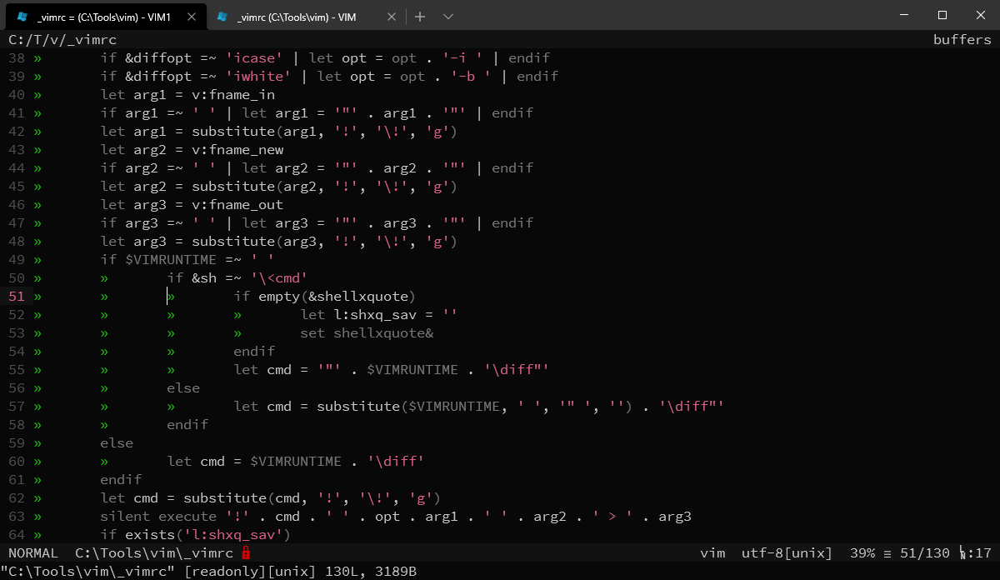 | 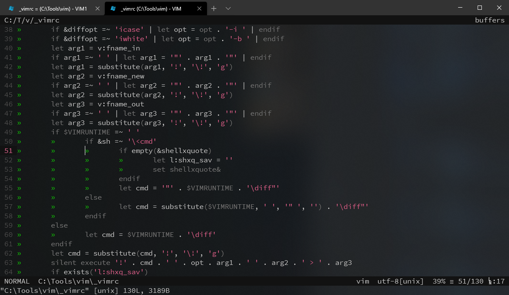 |
| --------------------------------------------------- | ------------------------------------------------- |
| xterm colors without shader                         | xterm colors with shader                          |

### Settings

Set the color value for the chromaKey used for transparency `float3(8.0f / 0xFF, 8.0f / 0xFF, 8.0f / 0xFF)` is the same as `rgb(8, 8, 8)`

```c++
static const float3 chromaKey = float3(8.0f / 0xFF, 8.0f / 0xFF, 8.0f / 0xFF);
```

## [Hue Shift](./hueshift.hlsl)

Changes the hue of screen colors. This can apply a color correction similar to the tint knob of old TVs or it can be set to cycle the colors smoothly over time.

### Preview

| 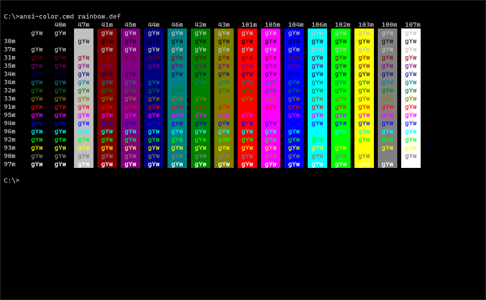 |  |
| ----------------------------------------------- | ------------------------------------------- |
| vintage colors without shader                   | vintage colors with shader                  |

### Settings

`HUE_OFFSET` [0.0, 1.0)f : Adjust the hue to a specific offset.  
`CHANGE_RATE` [0.0, 1.0)f : Changes the hue over time. For small values like 0.01f, this will cause a slow change over time and probably won't be very disruptive.  
`TOLERANCE` [0.0, 1.0)f : Saturation% setpoint. All saturation levels greater or equal than this will be affected by the hue adjustments. This allows you to fix some of the grayscale colors such as those offten used by on-screen text.

```c++
#define HUE_OFFSET 0.0f
#define CHANGE_RATE 0.01f
#define TOLERANCE 0.266f
```
